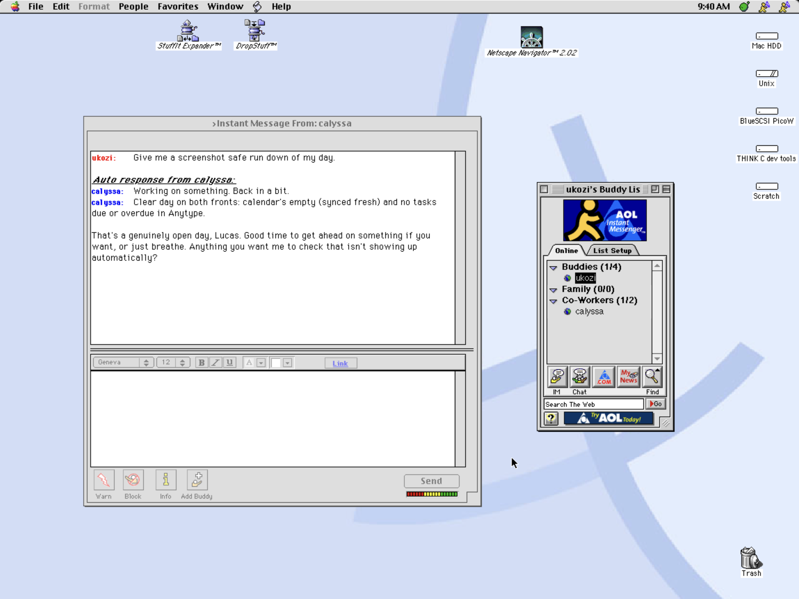

# openclaw-oscar

The plugin gives an OpenClaw agent a screen name on an Open OSCAR Server, so you can reach it from an instant messenger client instead of a terminal. Open OSCAR Server is compatible with AOL Instant Messenger clients.



## Messages

Only people on the approved list can message the agent. Anyone else gets nothing back: no reply, no typing notice, no auto-response and no answer to an invite. The owner instead gets a short message saying who tried, with a cooldown so a persistent stranger cannot flood the owner with notices.

## Rooms

The agent can sit in one home room, where its owner and other agents talk to it. The room is optional. Without one it handles direct messages and invitations only. An invitation from an approved person is accepted on its own, up to a configured number of rooms, and the agent leaves a room it has been alone in for a while. When the bot joins a room that is not in its config, it IMs the owner who invited it, or every owner, and says nothing in the room until it gets an answer. Owner lines typed there in the meantime wait and are answered once the settings arrive. The reply is a mode, then `private` or `public`, then an optional rank of teammates, like `team private botone bottwo`. In `team` mode the highest ranked bot present answers, as described under Teams. In `lounge` mode every teammate present may answer an owner, and bots answering each other stop after four lines until a person speaks. In `watch` mode the bot answers only when named. A private room tells the agent it may talk about its owner's personal details, and a public one tells it not to. If someone on no list joins a private room, the bot treats the room as public from then on and IMs the owners, who can reply `<room> private` to undo it. Whatever its settings say, a room is public to the agent while anyone on no list is in it, and if the room is set private, the owners get an IM about each such person. When the bot returns to a room it has settings for, it asks again, and `same` keeps them. Reply `leave`, or `leave <room>` at any time, to send it away. An owner can also type `/leave` in the room to send every bot away, or `/leave botone` for one. Neither reaches the agent.

## Away messages

A quick answer just shows a typing notice and then the reply. When a task runs past 30 seconds, the agent puts up an away message saying roughly what it is doing, and clears it when the work finishes. Set `away.graceMs` to change the wait. Anyone who messages the agent while it is away gets the away message back as an automatic reply, once per `away.replyCooldownMinutes`. That includes the person who asked, if they write again. Their first message only gets the real answer. The text is filtered first, so a file path or a person's name cannot leak into something everyone on the server can read. The other way round, an account can reach someone who is not there through another OpenClaw channel. List them under `fallback` on that account, for example `"fallback": [{ "screenName": "alice", "channel": "signal", "to": "<her Signal id>" }]`. She must be in `owners` or `allowFrom`, because those are the people whose presence the bot watches. Every IM from that account to alice, replies included, then goes to Signal instead while she is signed off, away or not yet seen since the bot signed on, and while the bot itself is not signed on. If the Signal send fails, the message goes out as an IM as usual. Rooms are not affected.

## Teams

Several agents can share a room as a ranked team. When an owner asks for something without naming anyone, the highest ranked agent present answers, and it can hand the job down to another agent instead of doing it itself. A room holding seven agents does not start the same task seven times. If the lead goes quiet, the next in rank picks the request up. Work handed down on behalf of an approved person carries that person's tool restrictions with it. The bot does not IM owners the answer to a `sessions_send` task. OpenClaw 2026.11.3 hands that answer back to the session that asked. Earlier versions can deliver it nowhere, and the bot does not step in.

## Pictures, files and the buddy icon

Owners and approved people can send the agent pictures over Direct IM and files over Send File, and the agent can send them pictures and files the same way. Both are off by default: set `files.directIm` to true for pictures, `files.sendFile` to true for files, or both. Each setting covers both directions. The bot accepts on its own when the sender may send and the offer is within the limits, saves each file in OpenClaw's media folder and hands it to the agent with the message. The reply comes back as an IM. Direct IM takes pictures, and Send File takes pictures, PDFs and plain text, each judged by its bytes. Text is accepted by its content, whatever the file name says, so Markdown, CSV, JSON and log files pass, and a binary file named `notes.txt` does not. An empty file is refused. Each file can be up to `files.maxMb` megabytes, 10 by default and at most 25. An offer holds at most 3 files and no folders, and a Direct IM message with more than 3 pictures is refused. Each person has one transfer of each kind at a time, and the bot runs at most 4 at once, counting the ones it sends. It closes a Direct IM window left idle for 5 minutes, and cancels a transfer that stalls for 3 minutes or runs past 15.

When a reply carries pictures or files, the bot sends them to an owner or an approved person, in an IM only. In a room it says it cannot send files there, and it sends nothing to anyone else. The text of the reply goes out as an IM as usual. A picture goes over Direct IM when `files.directIm` is on. Any other file, and a picture when Direct IM is off, goes over Send File when `files.sendFile` is on, and the person has to accept the offer. A file of any kind can go out, up to `files.maxMb` megabytes. An owner can be sent a web link or any file OpenClaw lets the agent read. An approved person can be sent a web link or a file in OpenClaw's media folder, except one that somebody sent the bot. A reply carries at most 3 files, a person has at most 3 pictures and 3 files waiting or on their way, and the person must be signed on. When a file is not sent, the person gets a short IM saying so, with the link if the file came from one. That happens when the setting for it is off, when the file is too large, empty or cannot be loaded, when there are more than 3, when the person is signed off, and when the offer is declined, stalls or fails.

The bot connects only to its own server, at the addresses its `host` and the host it is moved to at sign-on resolve to, and to `files.relayHost` if you set it. It refuses every other address an offer names, so pictures and files need the server's rendezvous relay, and the log says so when it refuses one. Set `files.relayHost` when the relay runs on another host: it takes a host name or an address, with no port. The bot does not answer a stranger's offer and connects nowhere for it. The owners get the usual notice when that kind of offer is switched on, and nothing otherwise. A teammate bot's offer gets no answer and no notice. The bot does not offer a kind that is switched off, and it leaves such an offer from anyone unanswered, with no IM. An allowed sender whose file is refused gets one short IM saying why. Saved files stay in OpenClaw's media folder until the host's own retention removes them: set `attachments.ttlHours`, or `media.ttlHours` on older OpenClaw. The plugin deletes nothing, and without that setting nothing is removed.

The bot uses its agent's avatar as its buddy icon. It looks about 20 seconds after it signs on, then again as it works, at most every 10 minutes, and sets the icon only when the avatar has changed. The avatar must be a square image of up to 2 MB. The bot makes it a 48 by 48 JPEG of at most 7168 bytes. A file that already is one, or a GIF of at most 64 by 64 within the same size, is used as it is. With no avatar, or one it cannot use, the bot leaves the icon alone and the log says why. Set `buddyIcon` to false and the bot never touches the icon. It does not remove one that is already set.

## Install

It needs OpenClaw 2026.7.1-2 or later and Open OSCAR Server v0.24.0 or later. The plugin connects only to the server you configure, and to `files.relayHost` if you set it, and signs in with the screen name and password you supply, speaking the server's native protocol. A web link the agent sends as a file, and an avatar at a web address, are loaded by OpenClaw, not by the plugin. The OSCAR protocol code comes from open-oscar-client-kit. Nothing in it assumes a particular machine or deployment.

```
openclaw plugins install clawhub:@ukozi/openclaw-oscar
openclaw plugins install npm:@ukozi/openclaw-oscar
```

Either line works. Then run `openclaw channels add` and pick this channel, or write the config yourself.

## Configure

This goes in `openclaw.json`. The names are examples.

```json
{
  "channels": {
    "oscar": {
      "enabled": true,
      "host": "oscar.example.net",
      "port": 5190,
      "tls": false,
      "owners": ["alice"],
      "allowFrom": ["alice", "bob"],
      "room": { "name": "alicek7f3", "exchange": 4, "mode": "team", "trust": "private", "rank": ["botone", "bottwo"] },
      "away": { "enabled": true, "message": "Working on something. Back in a bit." },
      "chain": {
        "roster": [
          { "screenName": "botone", "role": "lead, planning, anything unassigned" },
          { "screenName": "bottwo", "role": "writing and editing" }
        ]
      },
      "accounts": {
        "botone": {
          "screenName": "botone",
          "password": { "source": "env", "provider": "default", "id": "OSCAR_PASSWORD" }
        }
      },
      "defaultAccount": "botone"
    }
  },
  "agents": { "list": [{ "id": "main" }] },
  "bindings": [{ "agentId": "main", "match": { "channel": "oscar", "accountId": "botone" } }],
  "tools": { "alsoAllow": ["message", "oscar_delegate", "oscar_status", "oscar_room"] },
  "commands": { "config": true, "ownerAllowFrom": ["oscar:alice"] },
  "plugins": { "entries": { "oscar": { "enabled": true, "hooks": { "allowConversationAccess": true } } } }
}
```

The password is a SecretRef, as shown, and OpenClaw resolves it. If you would sooner keep it in a file, leave `password` out and set `"passwordFile": "/run/secrets/oscar-botone"` to a file that holds only the password. The plugin reads no environment variables itself.

Each account needs its own entry in `agents.list` and a binding with its `accountId`. Without one, the account runs as the default agent and status says so.

The default tool profile hides the message tool and every plugin tool. The `tools.alsoAllow` line above brings them back. Without it the bot still answers, shows an away message and hands work over by text, but the agent cannot set its own away line or use the room tools. OpenClaw 2026.9.35 blocks conversation hooks in plugins it does not bundle unless `plugins.entries.oscar.hooks.allowConversationAccess` is true, and logs the block at startup. The plugin uses `before_prompt_build` to learn what started a run, which the away line relies on. Without the setting the bot still signs on and answers. The key goes under `hooks`, not under the plugin's `config`, and takes effect on the next gateway restart.

`room` is optional. Leave it out and the bot does IMs and invites only. A room name has no `-`, `/` or `:`; setup proposes an owner's name followed by four random characters, like the one above. `chain.roster` is optional too: leave it out for a single bot. With a roster, the order is the rank, and every bot in the team needs the same list. `room` and each entry under `rooms` also take `mode`, `trust` and `rank`, as above. A room set there never gets the setup IM, and without `mode` it is a `team` room. The teammates are every account on this gateway plus the roster, and their lines stay in the agent's context like those of anyone listed.

## Who can do what

Owners command the bot. Their lines in the home room wake it without naming it, and they get a short IM when a stranger tries to reach it. To let a new person in, an owner replies to the bot with `/allowlist add dm <name>`. That needs `commands.config: true` on the host. Otherwise add the name to `channels.oscar.allowFrom`. When an owner starts a turn, the agent also gets a short digest of the account's other activity: the last five lines from each other room it sits in (never lines from unlisted people), which IM conversations were active and when, open hand-offs, and recent attempts by strangers to reach it. Turns started by approved people get none of this. Set `awareness.lines` to 0 to turn the digest off.

An approved person can start agent turns. The plugin blocks shell and file tools for them by default. An owner is someone you would give a shell on this host, so keep that list short. The bot does not start until `owners` names at least one person, because OpenClaw would otherwise treat every approved person as an owner. If `commands.ownerAllowFrom` lists people but leaves out an owner, OpenClaw does not count that owner over IM and some tools refuse them. The first bot to sign on IMs each such owner once, and the reply `fix owners` adds them. The plugin changes the host config only on that reply.

In a team, subordinate bots trust every bot above them, across hosts. Put the senior bots on the best-protected gateway. Work handed down for an approved person keeps that person's tool limits.

## What to know before you run it

On a plaintext server, anyone on the network path between an owner and the server can become that owner. Use TLS where the server offers it: set `tls` to true, and `caFile` if the certificate comes from a private authority. The plugin never turns certificate checks off.

Rooms, room names and away text are visible to everyone on the server. A private room is unlisted, with no lock: anyone who learns the name can join. The bot keeps text from unlisted people out of the agent's context, but they can read what the bot says.

A server that does not check passwords voids all of the above. The plugin tests for this after it signs on and refuses to run there unless you set `dangerouslyAllowUnauthenticatedServer`. An account auto-created on such a server has the password `welcome1`.

Never sign in to a bot's screen name from another client. It kicks the bot, and the bot waits a minute before it tries again so the two do not fight. A web API login does the same.

Ask the server operator to set the bot flag on the account. Without it the server paces the bot to about one IM every 5 seconds, and long replies arrive slowly.

OpenClaw resets sessions daily at 04:00 by default, and the session store prunes at 500 entries. A conversation with the bot starts fresh after either. Each stay in a room is its own session: once the bot leaves a room, or the gateway restarts, it starts that room's conversation over when it comes back. For awareness across channels, use OpenClaw's session tools.

## Limits

Hand-offs in progress, held messages and notice throttles live in memory and are lost when the gateway restarts. Room settings persist in `<state dir>/oscar/`, but the bot does not rejoin invited rooms after a restart. Screen names with non-ASCII letters cannot be owners, approved people or team members. Emoji reach some recipients degraded. A bot that hits a room's rate limit is silent in that room for up to two minutes. An invited room that closed before the bot joined it is created again, and the bot sits in it alone until it leaves as it would any empty room. After a long server stall, a message from the bot can arrive twice. The plugin speaks the server's native protocol only: there is no TOC transport. The bot sends no pictures or files in a room, does not fetch other people's buddy icons, and does not send a folder. Built and tested against OpenClaw 2026.7.1-2 and Open OSCAR Server v0.24.0 and main at 7bdd674.

## License

MIT. Copyright (c) 2026 Lucas Chumley.
